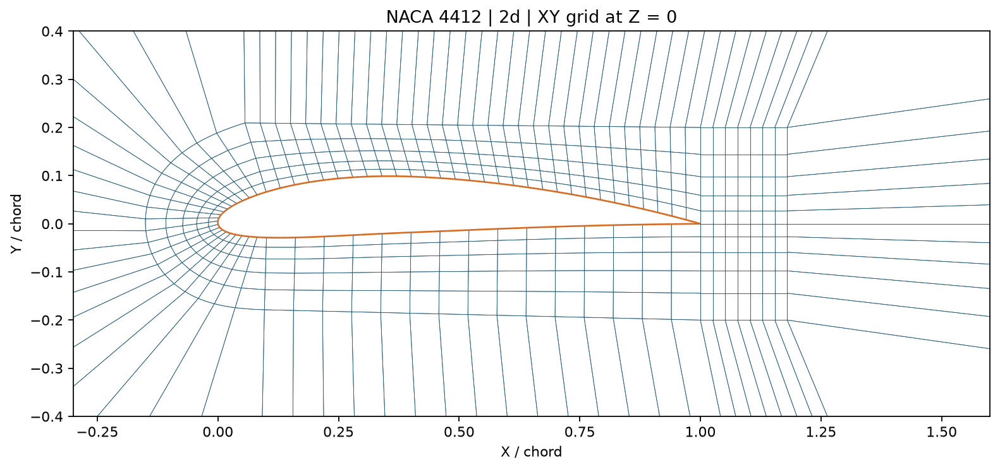
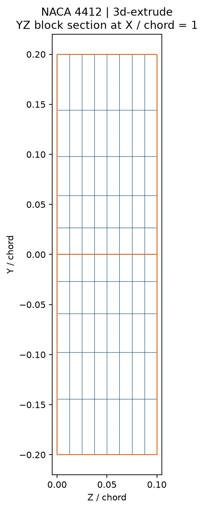
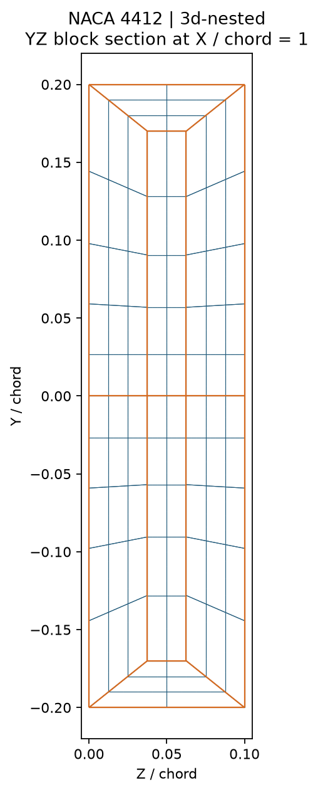

# Example configurations and grid previews

One shared folder contains the configurations and PNGs for all three modes.
These are coarse NACA 4412 grids intended for quick regeneration and inspection,
not a claim of simulation-ready resolution. All three use quadratic elements.

| Configuration | Mesh | PNGs in `images/` |
| --- | --- | --- |
| [2d.json](2d.json) | Full XY grid at Z=0 | `naca4412_2d_xy_domain.png`, `naca4412_2d_xy_airfoil.png` |
| [extruded.json](extruded.json) | Same XY grid, eight uniform Z layers | `naca4412_3d-extrude_xy_domain.png`, `naca4412_3d-extrude_xy_airfoil.png`, `naca4412_3d-extrude_perspective.png`, `naca4412_3d-extrude_yz_section.png` |
| [nested.json](nested.json) | Original nested spanwise blocks | `naca4412_3d-nested_xy_domain.png`, `naca4412_3d-nested_xy_airfoil.png`, `naca4412_3d-nested_perspective.png`, `naca4412_3d-nested_yz_section.png` |

`nested_coarse.json` remains as the older mesh-only configuration for compatibility.
It produces the same nested example when run with the default mode/order.

## Regenerate from the repository root

```sh
python generate_mesh.py --config examples/2d.json --output-dir examples --no-gui
python generate_mesh.py --config examples/extruded.json --output-dir examples --no-gui
python generate_mesh.py --config examples/nested.json --output-dir examples --no-gui
```

`mode` and `order` are stored in each configuration. Command-line overrides take
precedence. Mesh parameter counts in JSON retain the legacy node-count convention;
command-line `--upper-elements`, `--lower-elements`, and `--nose-elements` specify
elements. PNGs are saved in `examples/images/`. Meshes and quality reports are
generated locally and ignored by Git; the configurations and PNGs are committed.

The XY figures show the full domain and an airfoil close-up. The 3D perspective
shows the airfoil region, with display aspect expanding the thin span for
readability; axes still give actual coordinates. The YZ view shows the actual
meshed block interfaces at X/chord=1, restricted to the near-airfoil region.
It is a 3D diagnostic section, not the 2D grid mode. Quadratic edges are drawn
using their middle nodes and quadratic interpolation. Orange marks the airfoil
wall in 2D/perspective views and block boundaries in the YZ sections.

## XY airfoil grid



## Uniform extrusion versus nested spanwise blocks

| Uniform Z extrusion | Nested blocks |
| --- | --- |
|  |  |
